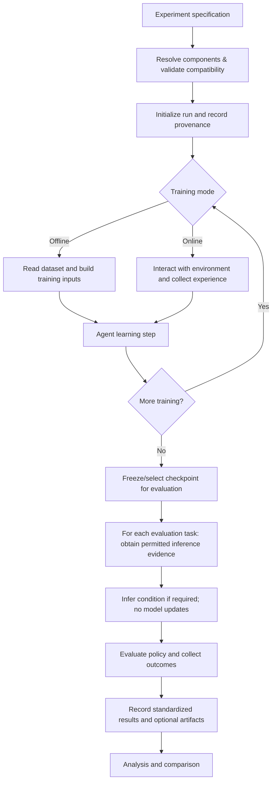

# Experiment Lifecycle — Architecture Specification

**Project:** Thesis RL research framework  
**Status:** Proposed foundation (Step 1); not an implementation contract  
**Scope:** Experiment execution, component responsibilities, data flow, and recorded results  
**Next step:** Derive domain models and then minimal protocols from this specification

## 1. Purpose

Build a research framework in which compatible reinforcement-learning algorithms, environments, datasets, tasks, and analysis procedures can be changed through **configuration and adapters**, without rewriting the experiment runner or modifying unrelated components.

The framework is primarily an **experimental research system**, not a universal RL algorithm library. Its core deliverable is a **reproducible, self-describing experiment record** that can be inspected and compared without understanding every algorithm's source code.

A successful usage pattern is:

1. Select a compatible agent, environment, data source, and task/evaluation protocol.
2. Run a standard lifecycle.
3. Obtain a standard result record plus optional algorithm-specific artifacts.
4. Compare runs using common analyses when their task and evaluation semantics permit comparison.

An interface does **not** guarantee that an arbitrary agent can handle an arbitrary observation or action space. Incompatibilities must fail early with a clear reason.

## 2. Design rules

**R1 — Exchange contracts, not shared internals.** Components exchange documented data, and the orchestrator only calls documented capabilities. An agent does not read a specific environment implementation or results directory; an analysis tool does not reach into private model members.

**R2 — One configured execution path.** A run is described by configuration, not a new script connecting components. The orchestrator must not branch on names like `if algorithm == "fb"`.

**R3 — Distinguish common and optional capabilities.** Acting, learning, task inference, representation inspection, and checkpointing are distinct capabilities. A component implements only what its configured lifecycle requires.

**R4 — Preserve algorithmic faithfulness.** A shared interface must not silently alter published objectives, sampling, target updates, exploration, task inference, or policy optimization. Record the selected variant and reference implementation/commit where applicable.

**R5 — Separate learning from evaluation.** Zero-shot task inference uses its explicitly permitted inputs and does not update model parameters. Evaluation must not leak test trajectories, privileged state, or evaluation-only rewards into task inference unless the declared protocol specifically permits them.

**R6 — Common meaning for common outputs.** Metrics, trajectories, checkpoints, configuration, and provenance have stable semantics. Algorithm-specific artifacts are optional and described by metadata/capabilities; missing artifacts must not be silently interpreted as zero or failure.

**R7 — Reproducible by construction.** Every run records sufficient config, software, data, task, and random-seed information to audit results. Resuming also requires training/optimizer, sampler, and relevant random-number-generator states.

**R8 — Keep domain objects independent.** Shared domain models should not need FB, Gymnasium, or PyTorch imports. External frameworks can enter through adapters; use library-specific types internally where necessary.

## 3. Terms and boundaries

| Term | Meaning | Distinction that matters |
|---|---|---|
| **Experiment specification** | Declarative choice of agent, data/environment, training mode, evaluation tasks, and recording options | Not executable algorithm code |
| **Run** | One execution of an experiment specification with a particular seed, version, and output identity | Many runs can share one specification |
| **Environment** | Interaction source defining observations, actions, and transitions | Not responsible for learning |
| **Dataset** | Persisted experience with provenance and interpretation rules | May be collected from a different behavior policy |
| **Agent** | Policy and (when supported) learning logic | Doesn't own orchestration or result storage |
| **Task specification** | External definition of a goal/reward/evaluation protocol | Not the agent's internal embedding `z` |
| **Task condition** | Algorithm-specific inference result used to condition action selection | May be absent for unconditional policies |
| **Analysis artifact** | Recorded data that enables a defined analysis | Separate from a mandatory training metric |

A task specification, task-inference evidence (for example labeled transitions), and inferred policy condition must remain separate. They have different provenance and leakage risks.

## 4. Lifecycle



The diagram shows the broad order, not a requirement to run every phase. Inference-only and evaluation-only runs can begin from an existing checkpoint. Some algorithms perform environment collection and learning in different cadences. The runner must support an explicit training mode or strategy rather than assume every learner consumes independent transitions.

### Phase A — Resolve and validate

**Owner:** Experiment orchestrator and component registry/factories (implementation later).  
**Inputs:** Experiment specification; registered component capabilities and data/space descriptions.  
**Actions:** Instantiate/resolve components; check compatible observation/action spaces; verify required capabilities and availability of the correct dataset or environment; check evaluation/task permissions.  
**Outputs:** Resolved immutable run specification or a clear incompatibility error.

**Guarantee:** The user should discover a mismatch (such as discrete-only actions versus continuous torque) *before* expensive training begins.

### Phase B — Initialize and record provenance

**Owner:** Experiment orchestrator and recorder.  
**Actions:** Assign run identity, set and record seeds, capture resolved configuration and environment/dataset identity, initialize necessary components, and record software versions and source revisions.  
**Outputs:** An initial run manifest.

Seeds improve reproducibility but cannot guarantee bitwise determinism across all hardware and libraries. The record should identify relevant nondeterminism when known.

### Phase C — Train (if requested)

**Owner:** Training strategy coordinated by the orchestrator; algorithm-specific learner/batch builder; data provider or environment collector.

- **Offline:** Read an identified dataset; create algorithm-specific training inputs from generic stored experience; call a documented learning capability; log step metrics.
- **Online:** Collect environment interactions through the policy interface; record transition data; sample/train using a declared update cadence; log collection and update metrics.
- **Mixed or model-based:** May require trajectories, sequences, rollouts, or model-specific internal structures. These are handled by explicit training strategies and specialized training inputs, **not** by forcing all algorithms into a `TransitionBatch` shape.

**Output:** Updated agent state, training metrics, and checkpoints where configured.

**Boundary:** The agent does not open a dataset file, choose its output folder, or call environment-specific helper methods as part of the generic learning interface. Algorithm-specific preprocessing or sampling is allowed behind its documented training boundary.

### Phase D — Select evaluation checkpoint

**Owner:** Orchestrator/recorder.  
**Actions:** Select the designated checkpoint (last, predeclared interval, or selection rule); preserve the selection rule and provenance.  
**Output:** Restored/frozen evaluation-ready agent.

No selection based on hidden test performance unless explicitly part of the declared evaluation protocol.

### Phase E — Task inference (if required)

**Owner:** Evaluation protocol supplies task specification and permitted evidence; agent's optional task-inference capability computes a condition.

**Inputs:** A task specification, explicitly allowed reward examples or other task evidence, and an evaluation-ready agent.  
**Outputs:** An agent-specific task condition plus task-inference metadata, or no condition if the agent does not require one.

**Guarantees:** No optimizer/parameter updates in zero-shot inference; evidence must be identified, auditable, and distinct from evaluation-only outcomes. If an algorithm cannot perform the requested task-inference procedure, fail clearly rather than invent a default.

### Phase F — Evaluate

**Owner:** Evaluator and environment adapter/dataset-based evaluator.  
**Inputs:** Selected agent/checkpoint, task condition if applicable, evaluation environment/tasks, seeds, episode or dataset protocol.  
**Actions:** Execute policy without learning; collect rewards/returns, success or other task-specific metrics, episode metadata, optional trajectories/videos/representation samples.  
**Outputs:** Standard evaluation records with task and checkpoint identifiers.

**Important:** Evaluation returns are not inherently comparable across environments with different reward scales, horizons, task definitions, or normalizations. A comparison must state the common evaluation protocol or normalization.

### Phase G — Persist and analyze

**Owner:** Recorder for persistence; analysis system for interpretation.

**Inputs:** Resolved specification, provenance, training/evaluation events, and optional artifacts.  
**Outputs:** A self-describing run record and analysis reports.

An analysis method should inspect artifact metadata/capabilities and gracefully state when required data were not collected. The analysis system should not silently rerun training or assume every agent has FB representations.

## 5. Who owns what?

| Component | Owns | Does not own |
|---|---|---|
| **Orchestrator** | Lifecycle progression; capability checks; wiring; phase boundaries | Model architecture or algorithm-specific losses |
| **Agent** | Action selection; its own trainable state; algorithm-specific updates and optional task inference | Environment dynamics; global experiment configuration; result storage |
| **Environment adapter** | Observation/action specifications; reset/step interaction; exposing supported task hooks | Training objectives; algorithm-specific encoders |
| **Data provider** | Dataset access, identifiers, provenance, consistent sample/trajectory retrieval | Agent architecture or optimizer state |
| **Training strategy / batch builder** | Cadence and algorithm-compatible training inputs | Changing the public meaning of recorded experience |
| **Evaluator** | Task execution, no-learning boundaries, outcome definitions | Training loop and network optimization |
| **Recorder** | Run identity, manifest, metrics, artifacts, checkpoints and references | Choosing what constitutes a correct scientific comparison |
| **Analysis** | Interpreting and comparing available recorded evidence | Assuming private algorithm implementation details |

The agent may compose internal encoders, actors, critics, replay helpers or world models. Those are implementation details unless explicitly exposed as optional inspection capabilities.

## 6. Information that crosses boundaries

These are **conceptual domain objects**, not final Python dataclasses or serialization schemas.

| Object | Minimum semantics | Used between |
|---|---|---|
| `ExperimentSpec` | Component selectors, training mode, data/environment identifiers, evaluation plan, seeds, output policy | User/config → orchestrator |
| `SpaceSpec` / compatibility description | Observation/action types, shapes and constraints, plus explicitly supported model capabilities | Environment/data ↔ factory/agent validation |
| `ActionRequest` / `ActionResult` | Observation, optional condition and policy memory, evaluation/exploration behavior; action and next memory | Runner/evaluator ↔ policy |
| `Transition` / `Trajectory` | Observed action and successor observation; optional reward; actual termination/truncation semantics; provenance when relevant | Environment/data → storage/training/evaluation |
| `TrainingInput` | Algorithm-defined batch or sequence assembled from generic experience | Training strategy → learner |
| `TaskSpec` / `TaskEvidence` / `TaskCondition` | External objective, permitted inference evidence, agent-specific conditioning result | Evaluator ↔ inference ↔ policy |
| `RunManifest` / `EvaluationRecord` | Resolved config and provenance; named metrics with task, checkpoint, and evaluation protocol context | Recorder → analysis |

**Do not finalize precise fields, tensor layouts, serialization libraries, or class hierarchies in Step 1.** Derive them from the first mock lifecycle in Step 2.

## 7. Minimum recorded outputs

A complete run must retain, either directly or through stable resolvable identifiers:

1. **Identity:** run ID, parent/group ID when applicable, timestamps, status (completed/failed/interrupted).
2. **Resolved configuration:** algorithm name and implementation variant, component settings, training/evaluation plan, seeds.
3. **Provenance:** code commit/version; dependency and hardware-relevant context; environment version; dataset ID/version/hash and collection protocol if applicable.
4. **Training record:** learning and collection step counts, typed/named metric streams, and logging step axes; applicable checkpoint metadata.
5. **Evaluation record:** evaluated checkpoint ID, task ID, permitted inference procedure/evidence, episode counts/seeds, outcome metric definitions, values, and units/normalization.
6. **Artifact index:** paths or identifiers, types/shapes/format versions, and optional capability labels for trajectories, videos, model representations, etc.
7. **Failure record:** stage, error and partial artifacts if execution fails.

Suggested conceptual layout (not a fixed on-disk schema yet):

```text
runs/<run-id>/
  manifest.*
  metrics/*
  evaluations/*
  checkpoints/*
  artifacts/*
```

**Analysis-critical constraint:** We must be able to tell whether a metric is training reward, validation performance, or final evaluation outcome; what step/episode it corresponds to; and what task/environment/checkpoint generated it.

## 8. Supported variations and early failures

The initial design must accommodate without orchestrator source changes:

- Different environments with the same action space but different observation encodings, **if supported** by the chosen agent or adapter.
- Different agents under a common evaluation protocol, **if compatible** with the task, action space, and training mode.
- Offline datasets and online environment collection as alternative experience sources.
- Algorithms that require independent samples, trajectories, sequences, or extra sampled latent/task variables.
- Optional task inference and optional representation inspection without adding unused required methods to every agent.

Examples of **explicit failures**: unsupported action/observation space, missing reward evidence for a declared task-inference method, missing required dataset fields, incompatible checkpoint version, evaluation protocol unsupported by the agent, or an analysis requesting an artifact that was not recorded.

## 9. Scientific validity and leakage checks

- Distinguish **reward-free pretraining**, **reward-labeled task inference**, and **reward-based performance evaluation** in configuration and logs.
- Do not leak a held-out task's rollout returns or private simulator state into inference unless the explicit experimental protocol allows it.
- Keep `terminated` and `truncated` distinct; never silently convert a time limit into an MDP terminal.
- Preserve raw observations/actions in dataset records where possible; let encoders/adapters transform them for the agent.
- Report missing or unsupported analyses as such; never impute metrics or create unearned cross-environment comparisons.
- Pin reference implementations and document deviations before claiming an FB reproduction.

## 10. Acceptance scenarios (before real FB)

We consider the architecture direction validated only when small mock implementations can demonstrate:

- **A. Environment interchange:** Run the same compatible fake agent against two environments through identical orchestrator logic; only configuration/adapters change.
- **B. Agent interchange:** Run two compatible fake agents against one environment with the same evaluation and recording pipeline.
- **C. Offline/online data:** Exercise offline and online modes with the same standardized result format, while honoring their different training strategies.
- **D. Task isolation:** Demonstrate reward-free training, permitted task inference, and evaluation as distinct phases; assert no learning updates occur during zero-shot evaluation.
- **E. Reproducible records:** Produce a manifest and evaluation record containing enough metadata to audit a result and link it to its checkpoint and task.
- **F. Controlled failure:** Reject one incompatible action space and one absent optional analysis artifact with clear explanations.

Passing these scenarios does not establish scientific correctness of FB; that requires separate reproduction and ground-truth tests.

## 11. Decisions and deliberate deferrals

### Decisions for the initial architecture

- The experiment lifecycle and output semantics drive the domain models and protocols, **not vice versa**.
- Domain models live separately from protocol definitions; protocols can be grouped by component (for example `contracts/agent.py`).
- The runner is algorithm-agnostic; algorithm-specific training details live behind capabilities/training strategies.
- Experiments are configured and recorded consistently; optional model internals are not universal requirements.
- Gymnasium is a pragmatic adapter target for interactive environments, **not a dependency of all core types**.

### Not decided yet

- Exact Python method signatures and generic parameterization.
- How capability discovery is represented (metadata, protocols, explicit compatibility objects).
- Serialization format, logging backend, and configuration library.
- Whether training strategies are classes, functions, or small composable objects.
- Exact `TaskSpec` representation for grid-world, OGBench, or other benchmarks.
- Full checkpoint-resume format and multi-process/distributed execution.

Prematurely fixing these would risk optimizing for the first FB implementation rather than the framework's long-term scientific purpose.

## 12. Next implementation milestone

**Step 2 — Domain models (minimal first pass).** Using the lifecycle above, define only what is needed for an end-to-end mock run: experiment specification, action request/result, experience record, task/evaluation identification, and a run/evaluation result. Add shape/type and provenance validation where meaningful, but avoid committing to torch/numpy tensor requirements in the core.

**Step 3 — Component protocols.** Place agent-related capabilities in `contracts/agent.py`, with other contracts introduced only when an actual mock execution requires them.

**Step 4 — Mock runner and contract tests.** Prove the acceptance scenarios before integrating the faithful original discrete FB baseline.

---

**Architecture test:** Can we change a compatible algorithm or environment *once* and rerun the experiment, evaluations, and available analyses without editing any unrelated implementation or rewriting an experiment script? If not, determine which boundary leaked implementation-specific knowledge before adding more abstraction.
