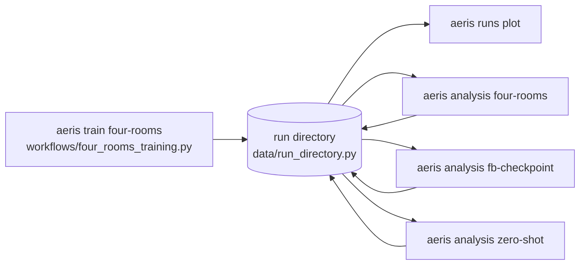

# Architecture overview

AERIS is a research framework for reproducible experiments with learning agents, built around
zero-shot RL with predictive representations. Its central product is a **self-describing run
directory**: everything needed to audit, analyze and plot a run is saved there as typed records,
so results can be inspected without retraining or reading algorithm code.

This page describes the code as it is. The design rationale it grew from is the
[experiment lifecycle specification](experiment_lifecycle.md); the precise semantics of the shared
data and interfaces are in [domain models](domain_models.md) and
[component contracts](component_contracts.md).

## Layers

| Package | Responsibility | May import (AERIS) |
|---|---|---|
| `domain/` | Typed records shared by everything: experiment specs, transitions, results, trajectories, space specs, policy snapshots, reports; JSON round-tripping (`JsonRecord`) and argument validation | nothing |
| `contracts/` | `Protocol` interfaces at component boundaries: agents, environments, datasets, recorders and readers | `domain` |
| `agents/` | Algorithms (today: discrete FB): networks, losses, batches, checkpoint files, algorithm-specific report schemas | `domain`, `contracts` |
| `environments/` | Environments (today: Four Rooms) and exact tabular models (`TabularDynamics`, `TabularMDP`) | `domain`, `contracts` |
| `data/` | All artifact file I/O: `RunDirectory`, NumPy formats for snapshots and datasets, run discovery | `domain`, `contracts` |
| `experiments/` | Generic, algorithm-agnostic loops: collection, training updates, goal evaluation, policy snapshots | `domain`, `contracts` |
| `analysis/` | Pure functions: validated models and typed records in, typed reports out | `domain`, `contracts`, `agents`, `environments` |
| `visualization/` | Matplotlib figures from typed records and analysis results | `domain`, `contracts`, `agents`, `environments`, `analysis` |
| `workflows/` | End-to-end procedures: open a run, check eligibility, read artifacts, call analyses, save reports, render | everything except `cli` |
| `cli/` | The `aeris` command: argument parsing and output only | `domain`, `data`, `workflows` |

```text
cli
workflows
analysis      visualization
agents        environments      data      experiments
contracts
domain
```

Each package imports only from packages on lower lines, and the four component packages on the
same line never import one another.

The rules that matter; `tests/test_architecture.py` enforces them as import rules:

- **Components do not know each other.** `agents`, `environments`, `data` and `experiments` never
  import one another; they meet only in `workflows`. A new agent therefore never needs edits in an
  environment, the recorder or the generic loops.
- **`analysis/` and `visualization/` never read artifacts.** They receive typed objects and cannot
  import `data/`; reading and writing run artifacts is the job of `data/`, orchestrated by
  `workflows/`. (`visualization/` writes only the figure files it is asked to create.)
- **Optional dependencies stay optional.** `domain` and `contracts` import neither NumPy nor torch.
  torch is imported only inside `agents/` (the FB package loads its torch-backed agent on first use)
  and inside the training workflow's function body; Matplotlib only inside `visualization/`
  functions. `aeris --help`, run browsing and the tabular analysis work without torch, and without
  Matplotlib when plots are skipped.

## Where validation lives

Inputs are checked once, where they enter, and are typed from then on:

| Boundary | Checked by | Example |
|---|---|---|
| Constructing a record | the record's `__post_init__` (`domain/`) | a metric value must be finite; a snapshot has one action per unique state |
| Reading an artifact | `from_dict` and `data/` readers | unknown/missing fields, wrong types, bad NPZ shapes, dataset fingerprint; errors name the file, line and field path |
| Exact models | `environments/` | `TabularDynamics` indices in range; `TabularMDP` discount in [0, 1); Four Rooms goal format and dataset coverage |
| Component compatibility | `SpaceSpec.require_compatible` | a checkpoint built for other observation/action spaces is refused |
| Run eligibility | `workflows/` | an analysis needs a completed Four Rooms run with one goal; the FB diagnostic needs the verified oracle dataset and a checkpoint matching the recorded agent settings |

`analysis/` assumes valid input and contains no input validation; its only errors are genuine
computation failures (value iteration not converging, non-finite network outputs).

## Life of a run



1. **Train.** `train_four_rooms_fb` builds the fixed dataset, writes the manifest (status `running`,
   full agent configuration, dataset fingerprint, library versions, AERIS git commit and whether
   the checkout had uncommitted changes), evaluates and snapshots the
   initial policy, trains, saves the checkpoint, evaluates again and marks the manifest `completed`
   (or `failed` with the error).
2. **Inspect.** `aeris runs list/show` read manifests and metric streams without importing any
   algorithm. Runs can be named by path, folder name under `--root`, or unique `run_id`.
3. **Analyze and plot.** Workflows read the typed artifacts, run the pure analyses and save typed
   reports under `analysis/` and figures under `figures/`; the original artifacts are never modified.

A run directory:

```text
runs/<name>/
  manifest.json             RunManifest: experiment spec, status, provenance, selected checkpoint
  dataset.npz               fixed training transitions (fingerprint recorded in the manifest)
  training_metrics.jsonl    TrainingMetricRecord per logged update
  evaluations.jsonl         EvaluationRecord per evaluated checkpoint and task
  trajectories.jsonl        EvaluationTrajectory per saved evaluation episode (optional)
  policy_<label>.npz        PolicySnapshot (labels: initial, final)
  checkpoint.pt             trusted torch checkpoint (agent and sampler state)
  analysis/*.json           AnalysisReport subclasses, e.g. tabular_policy_v1.json
  figures/*.png             rendered plots
```

## Extending AERIS

**A new agent** (for example one-step FB or TD-JEPA) goes in `agents/<name>/`:

1. a frozen config dataclass with a `spec` property (its `SpaceSpec`);
2. an agent class satisfying `Agent` and `TrainableAgent` (plus `Checkpointable`, and
   `TaskConditioner` if it infers task conditions from reward evidence);
3. a `BatchProvider` for its training inputs, and checkpoint save/load;
4. report records for any algorithm-specific diagnostics (subclasses of `AnalysisReport`).

Then add a training workflow in `workflows/` that records the agent's full config in the manifest,
and a `aeris train ...` command. The generic loops in `experiments/` and the recorder need no changes.

**A new environment** implements `Environment` and exposes a `spec`. Small diagnostic environments
with known dynamics can also implement `TabularModel`, which unlocks the exact-model analyses.

**A new analysis** is a pure function in `analysis/` returning an `AnalysisReport` subclass (which
names its artifact file), a workflow that checks eligibility and saves the report, and a CLI command.

## Status against the lifecycle specification

Implemented: typed domain and contracts; offline training with fixed, fingerprinted data;
goal-reaching evaluation with trajectory capture; zero-shot task inference from reward-labelled
pretraining data through the `TaskConditioner` contract, recorded with its evidence; atomic, typed run records with failure status;
`SpaceSpec` compatibility checks; exact-model analyses with typed reports; the `aeris` CLI; static
type checking and CI.

Not implemented yet, so the specification's rules hold only partly:

- **No resolver.** `ExperimentSpec` is recorded, not executed: each experiment has its own training
  workflow rather than one configured execution path (rule R2), and there is no component registry.
- **Online and hybrid training** and **resuming** from a checkpoint (sampler state is saved, but
  nothing restores it). Zero-shot inference is evaluated on Four Rooms goal tasks only; other
  reward families and evidence sources are not covered yet.
- **Provenance** records library versions, the dataset fingerprint and the AERIS git commit with a
  dirty flag (`aeris train` warns when the checkout has uncommitted changes), but not the diff of
  those changes or the hardware (rule R7).
